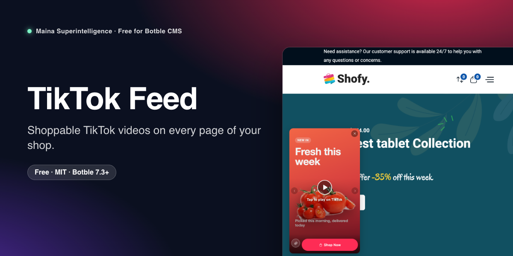
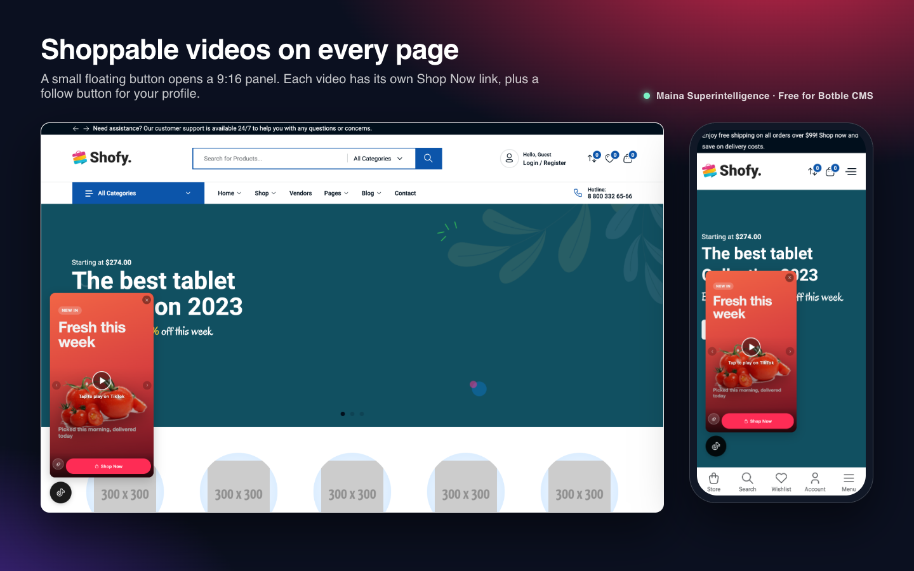
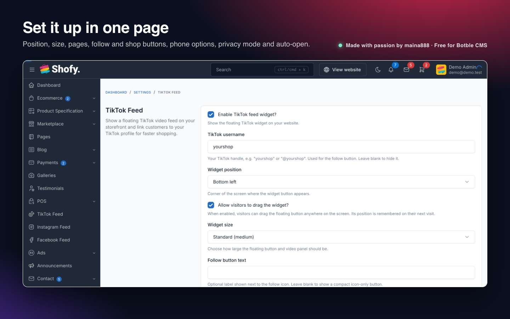
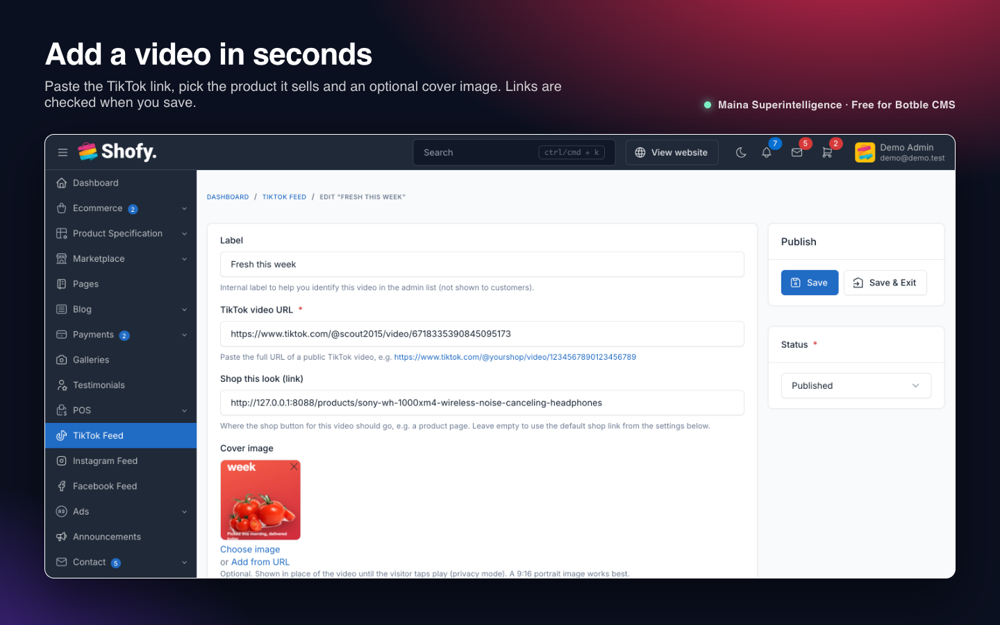
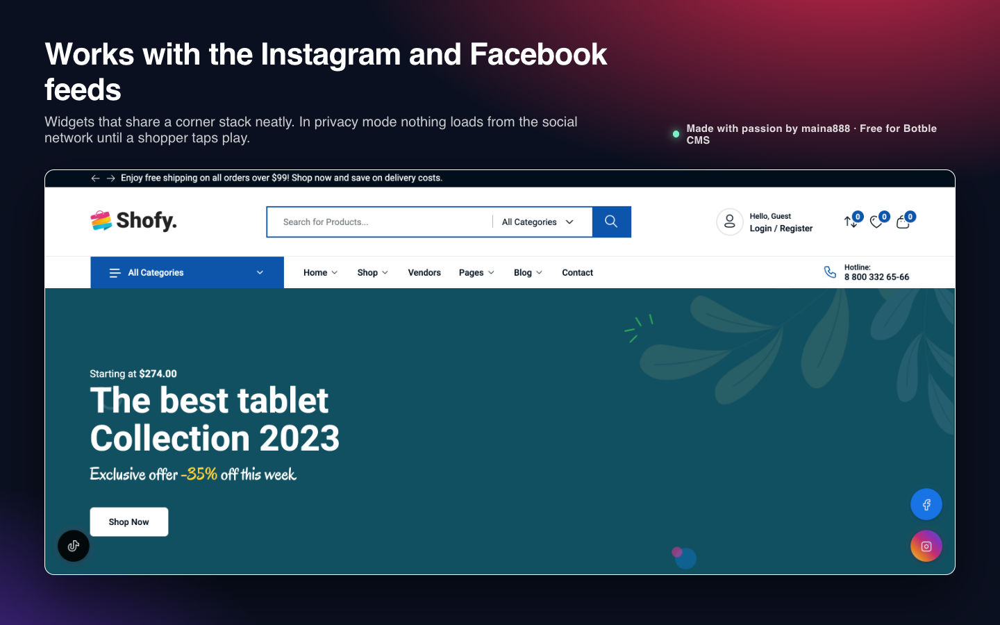

# TikTok Feed for Botble CMS



Put your TikTok videos on every page of your shop. A small floating button opens a swipeable 9:16 video panel with a "Shop Now" button for each video and a link to your TikTok profile.

**Free and open source** by **Maina 888** · Maina Superintelligence Ltd

**Version:** 1.1.0 · **Requires:** Botble CMS core 7.3.0+, PHP 8.2+ · **License:** MIT

## Features

- **Floating launcher** in any corner, with a subtle pulse. Visitors can drag it out of the way, and their position is remembered.
- **Video panel** (9:16) with a carousel for several videos, arrows and dots, and a close button. Escape closes it too.
- **Shop button per video:** link each video to a product page, or fall back to one default shop link.
- **Follow button** that opens your TikTok profile, icon-only or with your own label.
- **Three sizes:** Compact, Standard and Spacious.
- **Show on selected pages:** all pages, homepage, shop listing, product pages, cart or checkout (shop pages need the Ecommerce plugin).
- **Privacy mode:** show a cover image with a play button and load nothing from TikTok until the visitor taps it. Without privacy mode the video still loads only when the panel is opened, never on page load.
- **Cover images** per video, shown in privacy mode and in the admin list.
- **Phones:** show or hide on mobile, and lift the button above a theme's bottom navigation bar.
- **Auto-open** once per visitor after a delay you choose.
- **Works with the Instagram Feed and Facebook Feed plugins:** widgets in the same corner stack instead of overlapping.
- **Any theme:** the widget is added to the theme footer, uses its own small CSS and JS file, and needs no icon font.

## Screenshots

| Video panel | Settings |
| --- | --- |
|  |  |
|  |  |

## Requirements

- Botble CMS core 7.3.0 or later, PHP 8.2 or later.
- Any theme that prints the standard theme footer (all Botble themes do).
- Optional: the **Ecommerce** plugin, for the shop, product, cart and checkout page options.
- Public TikTok videos. Private videos and videos with embedding turned off cannot be shown.

## Installation

### From the Botble Marketplace (recommended)

1. Go to **Admin → Plugins → Add new**.
2. Search for **TikTok Feed**, click **Install**, then **Activate**.

Updates appear in **Admin → Plugins** whenever a new version is released.

### From a release zip

1. Download `tiktok-feed-x.y.z.zip` from the [latest release](https://github.com/Themaina/maina-tiktok-feed/releases/latest).
2. Go to **Admin → Plugins → Add new → Upload**, pick the zip, then **Activate**.

### Manually

1. Copy the `tiktok-feed` folder to `platform/plugins/tiktok-feed`.
2. Go to **Admin → Plugins** and click **Activate** (or run `php artisan cms:plugin:activate tiktok-feed`). Activation creates the `tiktok_feed_videos` table and publishes the CSS and JS.

### Updating from 1.0.x

Install the new version over the old one and keep the plugin active. A migration adds the `cover_image` column; your videos and settings stay as they are.

## Getting started

1. Go to **Admin → TikTok Feed → Create**.
2. Paste the address of a public TikTok video, e.g. `https://www.tiktok.com/@yourshop/video/7123456789012345678`. Optionally add a "Shop this look" link and a cover image.
3. Go to **Admin → Settings → Others → TikTok Feed**, enter your TikTok handle and choose where the widget appears.

## Configuration

**Admin → Settings → Others → TikTok Feed**

| Setting | What it does |
| --- | --- |
| Enable TikTok feed widget | Shows or hides the widget everywhere. |
| TikTok username | Your handle (`yourshop` or `@yourshop`). Used for the follow button; blank hides it. |
| Widget position | Bottom left, bottom right, top left or top right. |
| Allow visitors to drag the widget | Visitors can move the button; the spot is remembered in their browser. |
| Widget size | Compact, Standard or Spacious. |
| Follow button text | Optional label next to the TikTok icon. Blank shows an icon-only button. |
| Shop button text / Default shop link | Text of the shop button and where it goes when a video has no link of its own. The link can be a full `https://` address or a path such as `/products`. |
| Show on pages | All pages, or any of homepage, shop listing, product pages, cart and checkout. |
| Number of videos to show | 1 to 30 published videos, lowest display order first. |
| Show on mobile devices | Turn off to hide the widget on screens narrower than 768 px. |
| Distance from the bottom on phones | For bottom positions on phones. Raise it (e.g. 90 px) if your theme has a bottom navigation bar, as Shofy does. |
| Privacy mode | Shows the cover image and a play button; nothing loads from TikTok until the visitor taps play. |
| Auto-open on first visit / delay | Opens the panel once per browser session after the delay. |

**Admin → TikTok Feed** (one row per video)

| Field | What it does |
| --- | --- |
| Label | Internal name for the admin list. Also used as the iframe title for screen readers. |
| TikTok video URL | Full address of a public video. Short `vm.tiktok.com` links are rejected: open them in a browser and copy the full address. |
| Shop this look (link) | Where the shop button goes while this video is showing. |
| Cover image | Shown before the video loads in privacy mode. A 9:16 portrait image works best. |
| Display order / Status | Lowest number first. Only published videos are shown. |

## How it works

- The plugin hooks into the theme footer and adds one small CSS file, one JS file and the widget markup when at least one published video exists and the current page is allowed.
- Each video is shown with TikTok's official embed player (`https://www.tiktok.com/embed/v2/<id>`). The iframe address is only set when the visitor opens the panel or moves to that slide, or taps play in privacy mode, so a page view on its own makes no request to TikTok.
- The video id is read from the URL when you save, so the storefront never calls TikTok's API and no API keys are needed.
- Drag position (`localStorage`) and the "already auto-opened" flag (`sessionStorage`) stay in the visitor's browser. Nothing about visitors is stored on your server.
- When the Instagram Feed or Facebook Feed plugin is placed in the same corner, the widgets stack above each other.

## Customising

- **Styles:** every class starts with `tf-`, e.g. `.tf-toggle`, `.tf-panel`, `.tf-shop-btn`. Override them in your theme's CSS.
- **Markup:** copy `resources/views/widget.blade.php` to `resources/views/vendor/plugins/tiktok-feed/widget.blade.php` in your site root and edit the copy.
- **Translations:** copy `resources/lang/en/tiktok-feed.php` to `lang/vendor/plugins/tiktok-feed/<locale>/tiktok-feed.php` in your site root.

## Troubleshooting

| Problem | Fix |
| --- | --- |
| The widget does not appear | Check that it is enabled, at least one video is published, the current page is ticked under *Show on pages*, and (on phones) *Show on mobile devices* is on. Then run `php artisan optimize:clear`. |
| "This is not a TikTok video link" | Use the full address from the browser's address bar (`https://www.tiktok.com/@user/video/…`). Short share links do not contain the video id. |
| The panel stays blank or shows an error from TikTok | The video is private, deleted, or the creator turned off embedding. Use another video. |
| The button sits on top of the theme's bottom menu on phones | Raise *Distance from the bottom on phones*, e.g. to 90. |
| Old CSS after an update | The asset URL carries the plugin version, so a normal reload is enough. If a CDN caches `vendor/core/plugins/tiktok-feed`, purge it. |
| Cookie consent | Turn on *Privacy mode*: TikTok is contacted only after the visitor taps play. |

## Uninstall

Remove the plugin from **Admin → Plugins**. The `tiktok_feed_videos` table and all `tiktok_feed_*` settings are deleted. Uploaded cover images stay in your media library.

## Development

Unit tests cover video-id parsing, embed URLs and profile links:

```bash
composer require --dev phpunit/phpunit
vendor/bin/phpunit -c platform/plugins/tiktok-feed/phpunit.xml.dist
```

The storefront JS and CSS are built from `resources/js` and `resources/sass` with Laravel Mix (`webpack.mix.js`). The built files in `public/` are committed, so no build step is needed to use the plugin.

## File structure

```
tiktok-feed/
├── plugin.json
├── config/permissions.php
├── database/migrations/
├── public/{css,js}/          (built assets)
├── resources/{js,sass,lang/en,views}
├── routes/web.php
├── src/{Forms, Http, Models, Providers, Support, Tables, Plugin.php}
├── tests/
└── art/                      (marketplace images, not shipped in the zip)
```

## Support

- Questions and bug reports: [GitHub issues](https://github.com/Themaina/maina-tiktok-feed/issues)
- Security problems: see [SECURITY.md](SECURITY.md)
- Changes in each version: [CHANGELOG.md](CHANGELOG.md)

TikTok is a trademark of ByteDance Ltd. This plugin is not affiliated with or endorsed by TikTok.

## License

Free and open source under the [MIT License](LICENSE). © 2026 Maina Superintelligence Ltd. Made by Maina 888.
